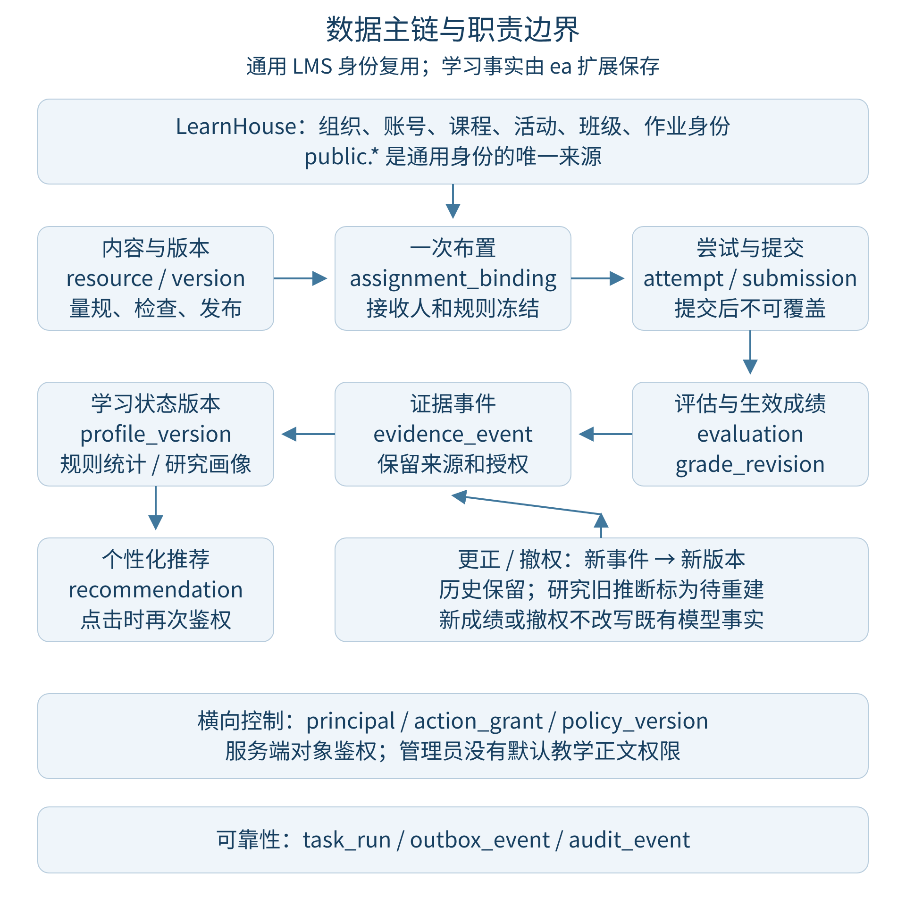

# 阶段二：数据库与接口设计说明书

日期：2026年11月20日　｜　状态：供开发实施的设计基线，非已上线功能说明

## 1. 顶层目标与设计决策

在 LearnHouse 通用教学底座上形成“内容生成与审核 → 发布和布置 → 学习作答 → 评估反馈 → 状态更新 → 推荐与教师干预”的可追溯闭环。学生、教师、管理员使用真实身份和服务端授权；管理权限不自动包含教学正文权限。

本轮扩展表统一使用 ea 命名空间，避免与上游同类记录形成双向权威。上游账号、课程、班级和作业的整数主键保留；扩展业务对象使用 UUID，审计 BIGINT 对前端以十进制字符串表达。所有业务时间采用 UTC timestamptz，显示时按用户时区转换。

设计交付包括 26 张表、350 个字段、41 个扩展 API 操作及 28 个页面的接口映射。完整 DDL、OpenAPI、字段字典、ER 源文件和离线验证脚本随包提供。

## 2. 数据主链

{width=5.2in}

图示为主要业务关系；全部 26 张扩展表及关系见 er.mmd，字段、外键、索引和检查约束以 schema.sql 为准。

## 3. 表清单与权威来源

| 表名 | 职责 | 修改约束 |
| --- | --- | --- |
| ea.principal | 组织范围内安全主体，引用上游用户或受限服务身份，不保存凭据 | 有限状态字段 |
| ea.action_grant | 细粒度动作授权及课程/班级/学生范围，独立批准和撤销 | 有限状态字段 |
| ea.policy_version | 组织允许策略或课程选择策略的不可变版本 | 只追加 |
| ea.task_run | 异步任务、幂等、租约、执行代次、有限重试与预算 | 有限状态字段 |
| ea.knowledge_point | 课程内知识点定义与版本 | 只追加 |
| ea.resource | 资料、课程内容或练习的稳定扩展身份 | 有限状态字段 |
| ea.resource_version | 原件、解析产物或生成内容的不可变快照与受限答案 | 只追加 |
| ea.rubric_version | 不可变量规及评分尺度 | 只追加 |
| ea.content_check | 同版本确定性校验或人工审批结果 | 只追加 |
| ea.publication_event | 按版本和班级的发布/撤回事件链 | 只追加 |
| ea.assignment_binding | 上游作业的一次布置版本，冻结资源、量规、策略及规则 | 有限状态字段 |
| ea.assignment_recipient | 布置时学生及班级快照，不替代当前授权 | 只追加 |
| ea.resubmission_grant | 特定学生任务补交/订正授权与有效期、额度 | 有限状态字段 |
| ea.attempt | 冻结题目版本的尝试及未提交私人草稿 | 私人草稿可改；提交冻结 |
| ea.submission | 不可变正式答案快照、请求摘要和回执 | 只追加 |
| ea.evaluation | 分离的规则评分、AI候选或教师判断 | 只追加 |
| ea.grade_revision | 唯一生效成绩链与更正历史 | 只追加 |
| ea.review_request | 对确切成绩版本的复核请求及一次性结案 | 有限状态字段 |
| ea.note_permission | 私人笔记画像用途和指定教师共享的独立同意 | 有限状态字段 |
| ea.evidence_event | 知识点证据摘要和原始业务引用，明确数据/判断来源 | 只追加 |
| ea.profile_version | 课程内学习状态成功版本，明确规则统计和研究原型边界 | 只追加 |
| ea.recommendation_version | 指定画像版本的推荐结果集 | 只追加 |
| ea.recommendation_item | 有外键的推荐目标、证据与理由 | 只追加 |
| ea.intervention_event | 教师对后续教学安排的干预及理由 | 只追加 |
| ea.outbox_event | 与业务同事务的出站事件或命令幂等回执 | 有限状态字段 |
| ea.audit_event | 只追加操作元数据，不存学生/模型正文或凭据 | 只追加 |

组织、账号、角色、课程、活动、班级、班级当前成员、作业身份和私人笔记正文继续由 public 表承接。历史接收人快照不能代替当前成员权限。退班后保留历史事实，同时拒绝新增访问；正文、附件下载、检索引用和旧 LMS 接口必须执行相同边界。

## 4. 关键业务规则

1. **版本冻结。** 布置冻结题面、答案、量规、策略和时间规则；旧提交不随新版本题面变化。研究生成内容维持强制复核，换版本不得清除门禁。默认自动发布路径只接经过明确检查的规则模板。
2. **作答不可覆盖。** 草稿可保存，正式提交追加一次；订正新建 attempt。重复点击通过幂等回执返回已有结果，冲突输入不得覆盖旧答案。
3. **评分建议与生效结果分离。** AI 建议不是最终成绩；每次改分追加 grade_revision 并保留理由。旧成绩节点不可删除或原地修改。工具失败不直接判错。
4. **补交有范围和时限。** 授权绑定学生、布置、截止时间和次数；超时或撤销后不能开始或提交新尝试。数据约束与服务端当前权限检查同时生效。
5. **笔记用途独立。** 私人阅读、共享给指定教师、用于画像三者不能互相推定。仅共享阅读不要求进入画像；撤销画像用途产生通用更正事件，可形成新版本，不能伪造一条新成绩。
6. **证据和研究状态分离。** 真实学生证据、历史证据、演示数据、规则统计、模型推断、工具观察保留原来源。生成题和参考答案不能自动构成掌握证据；未知不等于不会。
7. **异步结果重新核验。** 任务持有预算、租约、epoch 和冻结输入；应用结果前重新鉴权并核对版本。业务事件与 outbox 同事务提交；至少一次投递由消费幂等保证，不声称 exactly once。
8. **并发控制不是文档声明。** 唯一键和触发器已做隔离库检查；真实多连接竞争、worker 租约、事务 CAS 与迟到回调仍须在 API 实现阶段测试。

## 5. 接口约定与页面对应

统一前缀为 /api/v1/education。账号登录、刷新和退出复用 LearnHouse 原协议；扩展接口不另设假登录、不接受客户端自选用户身份。所有新增操作仍处于设计状态，OpenAPI 的存在不代表服务已经可调用。

每个操作声明页面编号、动作权限、涉及表和事务前置。写操作统一处理幂等键、预期版本、当前授权、来源门禁与审计。当前核心操作如下，详细请求、响应、错误码和示例见 openapi.json 与接口工作簿。

| 编号／方法 | 用途 | 页面 |
| --- | --- | --- |
| API01 GET | 读取真实会话与可切换授权视图 | C01 / C02 / S01 / T01 / A01 |
| API02 GET | 列出本人可访问课程元数据 | S01 / S02 / T01 / T02 / A01 |
| API03 POST | 创建课程草稿与本课程负责人 | T02 |
| API04 GET | 读取授权课程结构与资源入口 | S03 / T03 / T04 / T05 / T08 / T09 / T11 |
| API05 PATCH | 编辑课程与编排或选择允许策略 | T03 |
| API06 POST | 导入文本或PDF并创建来源版本 | T05 |
| API07 GET | 查看候选或已发布版本及授权正文 | S04 / T05 / T07 / T08 |
| API08 POST | 追加编辑版本并重新进入校验 | T07 |
| API09 POST | 发起研究生成或规则模板生成 | T06 |
| API10 GET | 读取任务元数据与产物引用 | T01 / T06 / A05 |
| API11 POST | 取消或幂等重试任务 | T06 / A05 |
| API12 POST | 执行确定性校验或人工审核 | T07 |
| API13 POST | 追加发布或撤回事件 | T08 |
| API14 GET | 列出课程作业与测验绑定 | S01 / S05 / T01 / T09 |
| API15 POST | 布置冻结版本到授权班级 | T09 |
| API16 GET | 读取作业规则、本人历史与回执入口 | S05 / T09 |
| API17 PATCH | 暂停关闭或归档任务 | T09 |
| API18 POST | 本人开始或幂等恢复一次新尝试 | S05 / S06 / S07 |
| API19 GET | 本人读取草稿与冻结题目 | S06 |
| API20 PUT | 保存本人草稿并递增草稿版本 | S06 |
| API21 POST | 提交冻结草稿并返回持久回执 | S06 / S07 |
| API22 GET | 列出授权任务正式提交 | T01 / T10 |
| API23 GET | 查看正式提交与当前生效结果 | S07 / T10 |
| API24 POST | 请求AI建议或保存教师候选评分 | T10 |
| API25 POST | 教师确认成绩或显式修订生效 | T10 / S07 |
| API26 POST | 学生申请当前成绩复核 | S07 / T10 |
| API27 POST | 教师保留或修订复核结果 | T10 / S07 |
| API28 POST | 授予个人有限补交或订正许可 | T10 / S05 / S07 |
| API29 GET | 读取课程内画像与证据摘要 | S08 / T11 |
| API30 GET | 二次鉴权读取证据原文 | S08 / T11 |
| API31 GET | 读取当前可访问的学习建议 | S01 / S08 / T11 |
| API32 POST | 记录教师干预并影响后续任务 | T11 / T09 |
| API33 GET | 查询账号班级与动作范围元数据 | A02 / A03 |
| API34 POST | 独立主体授予撤销范围或管理成员 | A03 |
| API35 GET | 读取允许策略和历史版本 | A04 / T03 |
| API36 POST | 追加全局或课程策略版本 | A04 / T03 |
| API37 GET | 读取能力预算队列与错误元数据 | A01 / A05 |
| API38 GET | 查询只追加业务审计元数据 | A06 |
| API39 POST | 本人授权或撤销笔记共享与画像用途 | S04 / C02 / T11 |
| API40 POST | 停用V2身份或撤销本人组织账号会话 | A02 |
| API41 GET | 读取学生明确共享的笔记原文 | S04 / C02 / T11 |

GET 请求也必须裁剪参考答案、他人作答、个人笔记、模型原始提示及密钥。学生只看到本人当前有权访问的已发布内容；教师按课程、班级及动作范围读取；管理员默认只接权限、策略、任务元数据和审计元数据。仅隐藏前端按钮不能满足权限验收。

## 6. 研究能力接线与明确差异

现有研究仓库固定到 099a875a。适配器支持 generate、profile、update、recommend 四种受控入口，默认只预览；已有 30 项离线检查，其中四种真实 CLI preview 通过，真实模型没有调用。

研究生成必须明确被授权的目标学生、非空知识点集合和模型请求次数预算。产品知识点 UUID 必须映射到研究目录的 code/version；整数用户 ID 必须经过绑定映射，不能用教师 ID 或假学生凑齐研究输入。教师明确目标出题已定义；完整 B 推荐历史向生成器的原样交接仍待接线。

客观题评分与教师评语不会直接变成 Java 原始作答。课程规则统计与研究画像用不同方法标记；当前研究不支持撤销旧推断，评分更正和笔记撤权后将研究状态标为 stale/待重建。不得将旧画像改标为新结果。

现适配器不支持原任务增加 epoch 后直接重跑研究任务，也没有供应商未知响应的自动恢复能力。研究重试操作暂时拒绝并在界面禁用；后续需要保留原检查点、输入、模型、预算和任务身份后设计恢复。未知请求不得靠换幂等键反复调用。

真实执行需要服务器受信授权与私有配置。请求次数上限不是人民币费用上限。不得把配置文件存在、假 transport 测试或界面成功提示写成“模型已接通”或“研究效果已验证”。

## 7. 迁移与验收

schema.sql 是一次性事务 DDL，面向固定 LearnHouse 版本与 PostgreSQL 14+；新增上游复合唯一索引以支持跨组织、课程和学生的外键一致性。首次迁移先做备份、前置检查和空库验证，禁止对未知版本直接运行。已有真实数据时优先前向修复，不通过 DROP CASCADE 或停用约束“回滚”。

本轮已执行隔离 PostgreSQL DDL 和 37 项正反例断言；最小上游结构 stub 测试数据最终全部回滚。另外，将真实 LearnHouse 106 张表的无数据结构副本恢复到独立空库，执行同一 DDL 成功提交，形成 public 106 表及 ea 26 表。没有复制业务数据或修改原库；此结果仍不能代表有数据升级、HTTP 权限及多连接并发已通过。详情见 validation-summary.json。

下一阶段按页面编号实施接口和前端，先完成一门课程的纵向闭环，再扩到全部页面。交付验收必须覆盖学生 A/B、教师甲/乙、管理员、过期会话、退班、撤权、跨课程 ID 替换、附件和旧接口旁路、双击提交、并发改分、迟到任务及恢复场景。

## 8. 绝对禁止事项

- 禁止在业务代码中调用 System.exit 或使用同类进程终止方式处理普通业务错误。
- 禁止拼接外部输入构造 SQL；必须参数绑定，动态标识符仅使用预先限定的安全映射。
- 禁止把密码、令牌、API Key 或私钥写死在代码、前端包、文档或日志中。
- 禁止新增已废弃 API；锁定依赖，按实际版本文档实现，不以忽略错误代替兼容修复。
- 禁止绕过 TLS 证书校验、对象鉴权、来源校验、预算门槛、强制复核或任务版本检查。
- 禁止在宿主机无人值守执行学生代码；本轮没有运行 Java 或任意学生程序。
- 禁止覆盖原始作答、改写旧评分与旧模型事实，或将演示数据伪装为真实学习证据。
- 禁止把仅页面演示、schema 检查、规则结果或模拟传输说成真实 AI 接通与研究成效。
- 禁止将管理员默认放开为全部正文读取，或仅用前端角色切换实现权限。
- 禁止无上限重试、未知请求自动重发、无限模型循环和因版本更新重置历史预算。

## 9. 配套文件

字段与索引：schema.sql、data-dictionary.json、数据库与接口交付清单.xlsx；接口：openapi.json、api-contract.md、api-page-mapping.json；关系：er.mmd；研究：research-integration-contract.md、research-adapter-status.md；检查：validation-summary.json、contract-cross-review.md。
