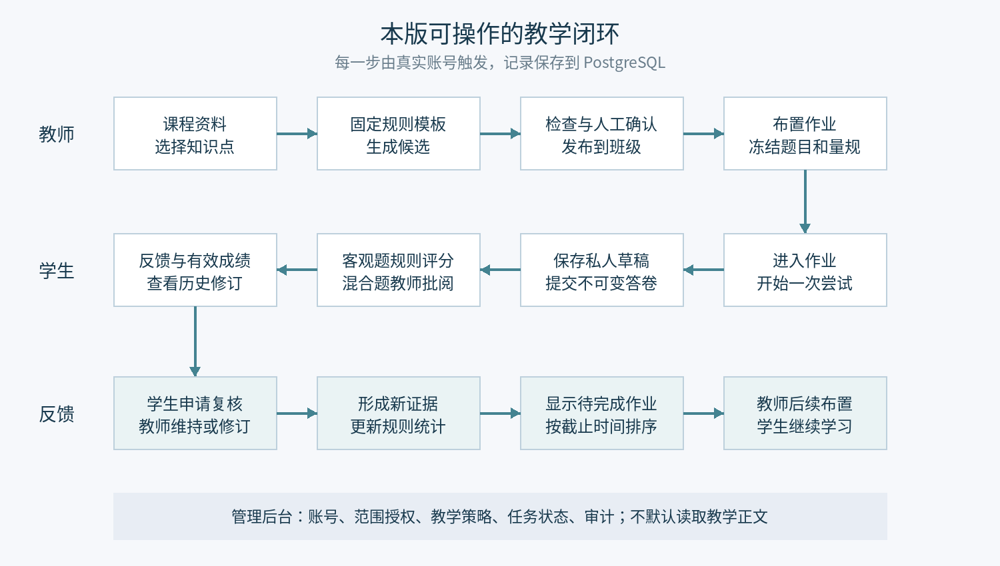
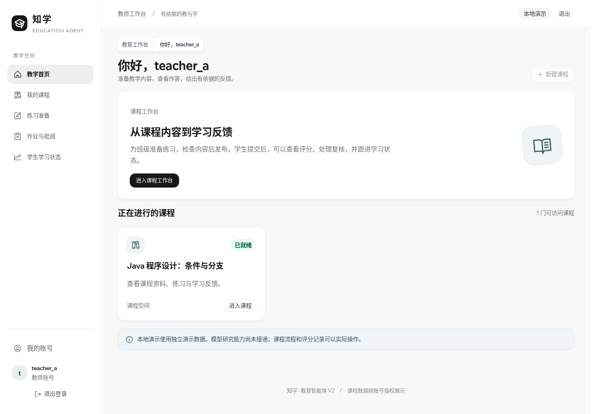

# 阶段三交付：教育智能体 V2 本地 Demo

**使用与开发说明　｜　2026 年 11 月 20 日**

## 1. 本阶段完成了什么

在 LearnHouse 社区源码上完成三类真实账号、业务页面和数据库读写，形成“教师准备与发布—学生作答—规则或教师评分—反馈与复核—统计更新”的教学闭环。此版已超出静态前端原型，但仍是本地开发 Demo，不是生产上线版本。

保留教师端，允许教师审核内容、评阅主观题和处理复核；管理员负责系统管理。国产芯片不作为硬性验收项，训练或微调方式不预设。真正的多智能体生成、认知双身、动态画像、研究推荐和教学质量算法尚待接入、独立验证；不得用当前规则结果代替研究结论。

技术底座为 Next/React/TypeScript 前端、FastAPI/Python 后端、PostgreSQL 与 Redis。复用上游账号、组织、课程、班级、活动和组件；新增 ea 数据域、范围授权、版本化学习事实和教学流程。LearnHouse 固定提交 c76cf6f64ab71ed042fe83e985d9c4ab3fa148f5；未另造账号协议或用角色切换按钮冒充权限。

## 2. 角色与可见范围

| 角色 | 可以操作 | 权限边界 |
|---|---|---|
| 学生 | 课程资料、本人作业、私人草稿、提交、成绩与复核、私人笔记 | 当前班级与本人数据；不能提前读答案或他人答卷 |
| 教师 | 课程设置、文本资料、固定模板、检查审核、发布布置、评分修订、复核、学习记录 | 逐动作核对课程/班级/学生范围；默认不能读取学生私人草稿或笔记 |
| 管理员 | 账号启停和撤销会话、教学范围授权、策略版本、任务与审计元数据 | 无教学正文和评分特权；不能给自己增加教学权限 |

预置学生 A/B、教师 A/B、平台管理员五个独立账号；A/B 分属两门课程与两个班级。所有账号、题目和学习记录均是合成演示数据，不是真实研究样本。新装时不预造作答或成绩，现场操作后才形成事实。

## 3. 页面清单与跳转

所有前端地址以 `/education` 开头；URL 中的角色只是导航入口，实际身份仍由服务端 Cookie 会话判定。下表的“页组”包含多个相同布局的详情和标签页，不以数量冒充原设计全部页面已完成。

| 页组 | 入口及路径 | 主要去向 |
|---|---|---|
| 登录与账号 | /login；/{role}/account | 登录后自动进入本人学生、教师或管理员首页；退出回登录 |
| 学生首页/课程 | /student；/student/courses；/student/courses/{id} | 课程概览、学习资料、作业、学习状态 |
| 学习资料与笔记 | /student/courses/{id}/resources；/student/resources/{id} | 阅读资料；课程页新增和读取本人笔记；授权UI待接 |
| 学生作业 | /student/courses/{id}/assignments；/student/bindings/{id} | 开始尝试、返回历史提交 |
| 作答与结果 | /student/attempts/{id}；/student/submissions/{id} | 保存、提交、反馈、复核申请、返回作业 |
| 学生学习状态 | /student/courses/{id}/state | 有效成绩统计、证据来源、下一步作业 |
| 教师首页/课程 | /teacher；/teacher/courses；/teacher/courses/{id} | 资料、练习准备、作业与批阅、学习状态、课程设置 |
| 教师练习准备 | /teacher/courses/{id}/generate | 选择来源、知识点和模式；生成后进入资源详情 |
| 教师内容版本 | /teacher/resources/{id} | 检查、人工确认、发布/撤回、布置、版本历史 |
| 教师作业/批阅 | /teacher/courses/{id}/assignments；/teacher/bindings/{id}；/teacher/submissions/{id} | 提交列表、逐题评分、生效、修订、复核处理 |
| 教师学情/设置 | /teacher/courses/{id}/learners；.../settings | 查看授权学生统计、记录教学支持；修改课程名称说明目标 |
| 任务详情 | /teacher/tasks/{id} | 可见任务状态及关联资源；未接通能力明确报错 |
| 管理后台 | /admin；/admin/accounts；/admin/access | 管理概览、账号与权限管理 |
| 策略/运维/审计 | /admin/policies；/admin/operations；/admin/audit | 追加策略版本、检查能力状态、查看操作元数据 |

课程创建按钮在本版禁用；课程由初始化提供。章节编排、文件/PDF 解析、独立知识图谱、导出和完整计划页等仍属于后续扩展。

{width=6.5in}

## 4. 一次完整演示怎么操作

**教师准备。** 用教师 A 登录，进入 Java 条件与分支课程，在练习准备页选择来源和知识点，使用固定规则模板。它生成预置布尔练习，不是读懂任意教材后的 AI 出题。打开候选后执行结构与答案校验，再由教师确认。发布到 A 班后填写标题、时间、次数及反馈策略并布置。

**学生完成。** 退出教师账号，用学生 A 登录，进入刚布置的作业。开始尝试后选答案并保存草稿；确认提交会产生不可变答卷。全客观练习按固定答案自动评分，混合练习进入等待教师状态。预置混合练习可用于演示人工批阅。

**教师批阅。** 在作业与批阅中打开答卷，逐题填写分数和反馈，保存评分并生效。改分必须填写原因，新增成绩版本，旧成绩与原答卷保持可追溯。两人基于同一旧版本同时改分时，后完成者须刷新核对。

**学生复核。** 在结果页填写复核理由；教师可以维持或修订结果。修订生成新成绩并关闭复核，不覆盖原始记录。生效成绩更新规则统计，研究画像仍显示未接通。

**笔记授权。** 在课程中保存和读取私人笔记。独立的教师阅读/画像用途授权及撤回已在后端实现并通过接口验收，但本版页面尚未提供授权按钮；不得把后台接口能力当成页面已完成。当前没有笔记画像分析任务，因此授权不意味着已经分析，也不会据此生成虚构画像。

**管理员操作。** 使用管理员账号进入账号、权限和策略页面。账号停用阻止 V2 访问；撤销会话使旧会话失效。授权只能面向其他账号并限定范围。策略以新版本保存，新动作使用当前策略；已有作业、题目和量规继续保留冻结版本。

{width=6.5in}

## 5. 本地启动与交付方式

当前已配置工作区执行 `python scripts/local_demo.py start`，打开 `http://localhost:3300/education/login`。账号邮箱与随机密码保存在本机 `.runtime/demo-accounts.local.json`。使用 `python scripts/local_demo.py stop` 停止本脚本拥有的前后端进程，数据保留。

完整安装、依赖、空库初始化、日志定位和 Windows/WSL2 边界见根目录 RUN_LOCAL.md。源码包包括修改后的社区源码、数据库设计、初始化及验收脚本；不附带依赖、数据库、密钥、Cookie 或当前环境密码。没有发布网站，也没有推送 GitHub。

已验证环境是 Linux x86_64、Node 20.19.5、Bun 1.4.4、Python 3.14.7、PostgreSQL 14.24、pgvector 0.8.1、Redis 6.0.16。API 依赖沿用上游锁文件，另以 requirements-demo.txt 增补 jsonschema。新机器安装、Docker、macOS、生产构建与部署迁移尚未验收，不能将当前工作区验证扩大为这些环境已验证。

## 6. 异常与恢复

| 状态 | 用户操作 | 系统行为 |
|---|---|---|
| 会话失效或账号被停用 | 重新登录；停用由管理员处理 | 服务端拒绝访问，不能通过改URL继续使用 |
| 版本冲突 | 刷新、核对新内容后重新操作 | 不覆盖其他人的更改 |
| 网络失败或按钮重复点击 | 等待结果或重试同一操作 | 幂等键防止重复创建提交/成绩 |
| 题目被撤回 | 选择其他可用作业或联系课程负责人 | 阻止新尝试；已有尝试和历史记录保留 |
| 研究能力未配置 | 继续使用已实现规则或教师流程 | 返回明确不可用状态，不伪造模型结果 |
| 数据库不可用 | 检查本地服务和日志 | 返回受控错误，不展示 SQL 或答案参数 |

## 7. 二次开发位置与契约

前端：apps/web/app/education 与 components/education。后端：apps/api/src/education。上游 app.py 和 events.py 仅在 EA_DEMO_MODE=1 时接入专用边界并关闭上游后台任务；旧 LMS 内容、作业、AI、代码执行入口在本实例中关闭，避免绕过对象权限。本开关不能直接应用到承载其他业务的生产实例。

复用账号与课程身份，业务事实保存在 ea 的26张扩展表。所有写命令按身份、操作与幂等键串行处理；前置版本和对象权限在服务端校验。不可变题目、提交、评分与证据由数据库约束进一步保护。详情见 business-implementation.md、actual-contract-delta.md，以及阶段二冻结设计。响应扩展和实现缺口单独登记，不声称设计中的41个操作全部完成。

本版额外提供课程内本人笔记读取/新增接口；尚无笔记编辑/删除和研究用途消费。管理员采用 access.manage 委派教学动作的本地 Demo 规则；不实现多级授权审批或管理员创建。管理员审计当前记录成功命令元数据，不是完整失败安全事件审计。正式游标分页、可靠异步任务和大规模数据处理也需下一阶段补齐。

## 8. 绝对禁止事项

1. 禁止在业务处理中调用 System.exit、杀进程或用吞异常冒充成功。
2. 禁止把外部输入拼接进 SQL；所有值必须绑定参数，动态表名/排序必须受可信白名单约束。
3. 禁止硬编码或公开密码、API key、Cookie 和数据库连接密钥；禁止提交真实学生数据到公共仓库。
4. 禁止新增已废弃 API、关闭 TLS 校验、忽略依赖或构建失败后宣称成功。
5. 禁止仅靠隐藏按钮、前端角色或 CORS 代替服务端对象鉴权；管理员不得默认读取教学正文。
6. 禁止在宿主机直接执行学生代码、向浏览器开放通用命令执行、由用户指定服务端执行路径。
7. 禁止覆盖已提交答卷、历史成绩与研究事实；更正必须追加记录并可追溯。
8. 禁止把固定模板、统计结果、演示数据或未执行的模型调用写成真实研究成果；没有实验不得宣称教学效果提高。
9. 禁止未授权外部模型调用、无限重试或将私有学习材料发送给未配置的外部服务。

## 9. 下一阶段及独立交付

下一阶段接入原 education-agent 的真实研究服务：先实现受控任务执行与结果契约，再依次接通生成、画像和推荐；同时保留规则、教师与研究三种来源。交付模型配置和预算约束说明、任务源码、真实调用记录、失败与撤销测试、研究输入输出样例，以及与无个性化基线的对照评估方案。只有实际实验结果支持时才报告研究效果。
